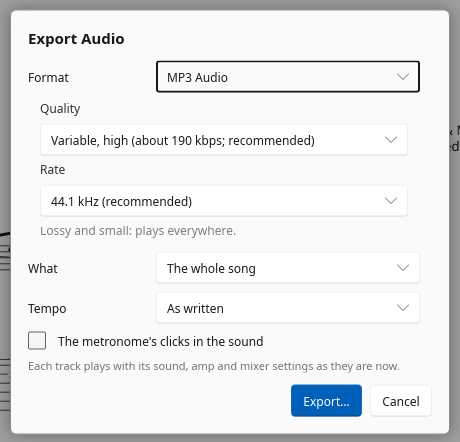

# oxiguitar-export

The audio export plugin for [OxiGuitar](https://github.com/mateusrdp/oxiguitar), a free, open-source guitar tablature and score viewer, editor and player for Windows, macOS and Linux. It adds the formats of **File → Export Audio…**: OxiGuitar plays the whole song, or the selected bars, through its instruments, amps and mixer faster than real time, as written or at your practice speed, and this plugin writes the sound as a **WAV**, **FLAC**, **MP3** or **Opus** file.

- Plugin file `export.oxp`, id `oxiguitar.export`. Until 0.1.2 it was the WAV plugin (`oxiguitar-wav`, `wav.oxp`, id `oxiguitar.wav`); it replaces that id, so OxiGuitar uses this one even when the old file is still installed. You can remove the old package (`oxiguitar-wav`, or the Flatpak `io.github.mateusrdp.OxiGuitar.Plugin.wav`).
- Each format's choices show in the export dialog under its **Format** list, kept with **Export…** and forgotten with **Cancel**:

| Format | Choices | Default |
| --- | --- | --- |
| WAV | 16-bit (with dither), 24-bit or 32-bit float; 44.1 or 48 kHz | 24-bit, 48 kHz |
| FLAC (lossless) | 16-bit (with dither) or 24-bit; 44.1 or 48 kHz | 24-bit, 48 kHz |
| MP3 | variable bitrate (V0, V2, V4) or constant (128 to 320 kbps); 44.1 or 48 kHz; gapless (LAME Info/Xing tag) | V2 (about 190 kbps), 44.1 kHz |
| Opus (in Ogg, `.opus`) | 96 to 256 kbps; always 48 kHz | 160 kbps |



- It needs an instrument plugin to make the sound (the [MIDI plugin](https://mateusrdp.github.io/oxiguitar-midi/)) and a format plugin to open the score, such as the Guitar Pro plugins. `oxiguitar-cli export SONG.gp5 SONG.flac` does the same from the command line, with the choices last kept.

## Manual

The manual is at <https://mateusrdp.github.io/oxiguitar-export/>. Its source is in [docs/manual](docs/manual). It covers what the plugin is for, how it works, what it needs and how to install it.

## Install

Every [release](https://github.com/mateusrdp/oxiguitar-export/releases) holds a zip per system (Linux x86_64 and ARM64, Windows x86_64 and ARM64, macOS), a `.deb` and an `.rpm` for Linux, a per-user Windows installer (no administrator needed), a macOS `.pkg`, and a `SHA256SUMS` file. The [manual's install page](https://mateusrdp.github.io/oxiguitar-export/install.html) says which one to use and how to keep it updated. The plugin needs OxiGuitar with plugin interface 1.11 (the release after 0.21.1).

## Build and test

Rust 1.99 or later from [rustup](https://rustup.rs). The plugin SDK comes from OxiGuitar's repository by git tag; nothing of OxiGuitar's is on crates.io.

```sh
cargo test          # unit tests, and the contract suite on the built .oxp file
./build-oxp.sh      # dist/export-VERSION-SYSTEM-ARCH.oxp
python3 scripts/test-all.py   # every test, as the manual's Testing page says
```

## Credits

The encoders are pure Rust, used as published:

| Crate | Authors | Licence | For |
| --- | --- | --- | --- |
| [rusty_flac](https://github.com/Remade-With-Rust/rusty_flac) | Mata Network (Remade With Rust) | Apache-2.0 | FLAC |
| [rusty_mp3](https://github.com/Remade-With-Rust/remade_ffmpeg_rs) | Mata Network (Remade With Rust) | Apache-2.0 | MP3 |
| [opus-pure](https://github.com/stephenberry/opus-pure) | Stephen Berry and restsend.com; a port of libopus (Xiph.Org, Skype Limited, Octasic and others) | BSD-3-Clause | Opus and its Ogg pages |

## History

This plugin lived in the OxiGuitar repository until its version 0.11.0. Its history came along; an issue number such as `mateusrdp/oxiguitar#123` in an old commit message is in that repository.

## Licence

GPL-3.0-or-later. See LICENSE. Contributions are welcome under the same terms; see [CONTRIBUTING.md](CONTRIBUTING.md).
