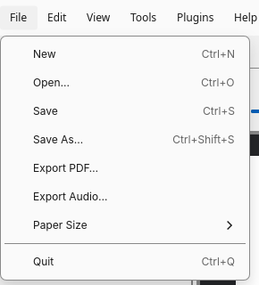
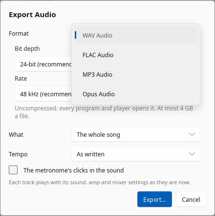
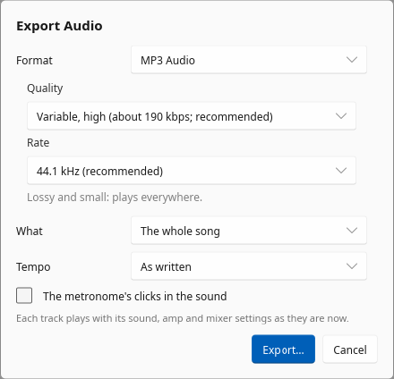

# How to use it

## Export a song

1. Open the song, and set it up the way you want to hear it: each track's sound, amp, equalizer, volume, pan, mute and solo all go into the file as they are.
2. Choose **File → Export Audio…**:



3. Pick a **Format**:



4. Set the format's own choices, which appear under the Format list (the table below lists them), and then:
   - **What**: the whole song, or only the bars you selected before opening the dialog.
   - **Tempo**: as written, or at the practice speed you set in the player. The pitch stays the same either way.
   - **The metronome's clicks in the sound**, if you want to play along with a click.



5. Click **Export…**, and choose where to save the file. A three-minute song takes a few seconds.

The choices are kept for next time when you click **Export…**, and forgotten when you click **Cancel**.

## Which format?

| Format | Choices | Default | Use it for |
| --- | --- | --- | --- |
| WAV | 16-bit (with dither), 24-bit or 32-bit float; 44.1 or 48 kHz | 24-bit, 48 kHz | Loading into another audio program; anything that needs plain, uncompressed audio |
| FLAC, lossless | 16-bit (with dither) or 24-bit; 44.1 or 48 kHz | 24-bit, 48 kHz | Keeping a master copy at half the size of WAV |
| MP3 | variable bitrate V0, V2 or V4, or constant 128 to 320 kbps; 44.1 or 48 kHz | V2, about 190 kbps, 44.1 kHz | Sharing: every phone, car and player plays it |
| Opus (`.opus`) | 96 to 256 kbps; always 48 kHz | 160 kbps | Sharing, smaller than MP3 for the same quality |

The [overview](index.html) explains bit depth, sample rate, dither and lossy formats if any of that is new.

## Practise with it

- **Loop a hard passage**: select those bars, export only them, and loop the file in any player. MP3 and Opus exports are gapless, so the loop doesn't stutter.
- **Slow it down**: set the player's speed to 70 %, then export with **Tempo** at the practice speed.
- **Make a backing track**: mute the part you want to play yourself, then export.

## From the command line

```sh
oxiguitar-cli export SONG.gp5 SONG.flac
```

The format comes from the file's extension, with the choices you last kept in the dialog.

## Good to know

- Nothing needs a sound card: the song is rendered as fast as the computer can.
- The file is written under a temporary name and renamed only when it is complete, so a cancelled or failed export leaves nothing behind.
